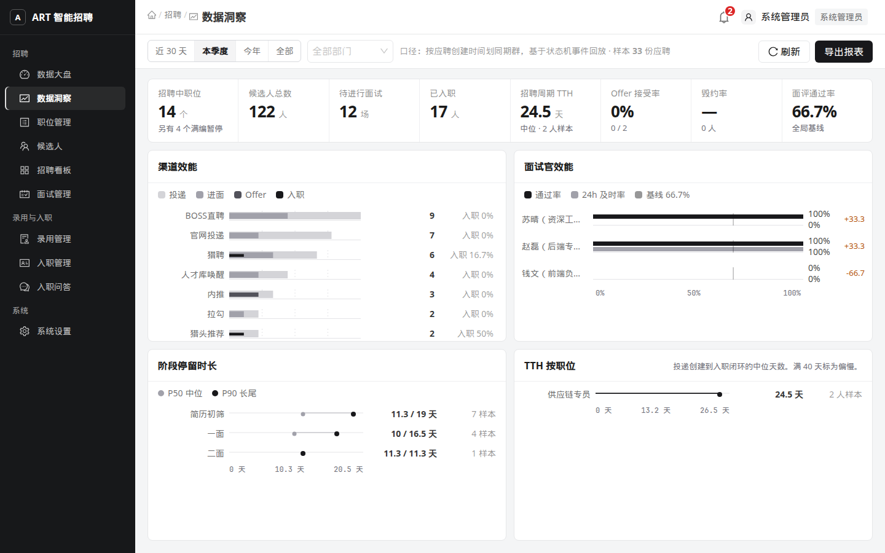
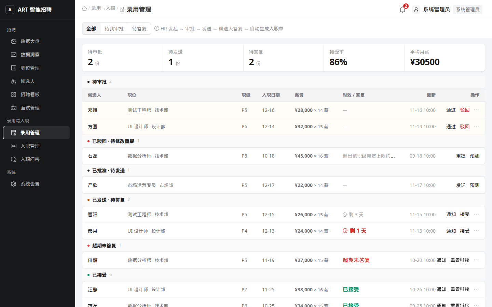
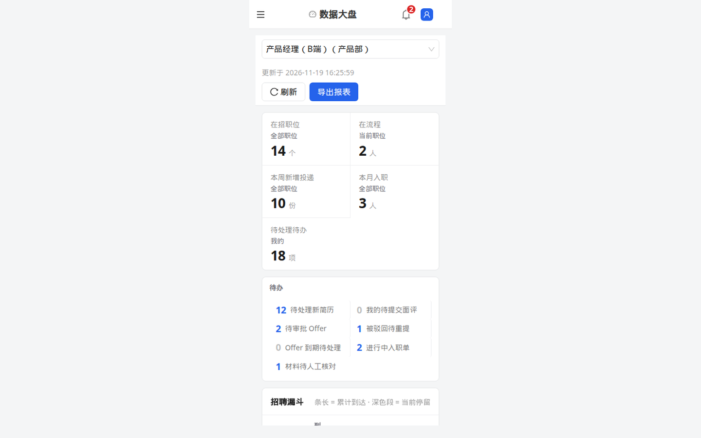
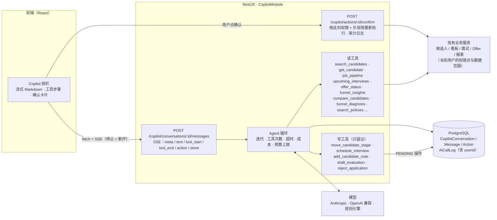

# HireFlow

给招聘团队用的全栈 ATS：职位、候选人、面试、Offer 和入职在同一条流程里。

<table>
  <tr>
    <td width="400" valign="top">
      
      <br />看板：按阶段拖动候选人
    </td>
    <td width="400" valign="top">
      
      <br />洞察：渠道、面试官和招聘周期
    </td>
  </tr>
  <tr>
    <td width="400" valign="top">
      
      <br />录用：发送 Offer 和候选人答复
    </td>
    <td width="400" valign="top">
      
      <br />手机宽度：指标收成两列
    </td>
  </tr>
</table>

## 功能

侧栏只有 5 项：**看板**（含职位、面试页签）、**候选人**、**录用入职**（Offer、入职页签）、**数据**、**设置**。

- 看板固定 4 个系统阶段：筛选 → 面试 → 录用 → 入职，可以改名、可以在中间插入自定义阶段。自动流转按阶段**类型**判断（改名不影响）：安排面试进「面试」，发出 Offer 进「录用」，候选人接受 Offer 进「入职」，HR 确认入职后标记为已入职。面试轮次是卡片上的标签（如「二面 · 待评价 1/2」），不再占一列。
- 职位状态：草稿、招聘中、暂停、关闭。没有审批流：HR 直接发 Offer。
- **候选人页**：一条应聘一个免登录链接，HR 复制后发给候选人。候选人在同一页里选面试时间、答复 Offer、填写入职信息、阅读并确认劳动合同，也能问入职问题（按公司制度文档回答并给出处）。
- **上传简历自动建档**：选好职位，拖入一份或多份 PDF / Word（.docx）/ 纯文本。系统抽出文字、用正则识别姓名、邮箱、手机号（联系方式不交给大模型），按邮箱或手机号去重——已有档案就合并并补上空字段，否则新建；然后 AI 解析回填技能标签、投递所选职位、AI 匹配评分。解析或评分失败只记为提醒，不影响建档。扫描件、图片和 .doc 需要手工建档。
- **候选人列表**：按职位、阶段、应聘状态、来源、最低匹配分、建档日期筛选，条件都在网址里；可按当前筛选导出 Excel（单次最多 5000 人，联系方式脱敏口径与列表一致，导出动作记审计）。
- **时间轴**：候选人详情里按时间列出建档、流转、面试、Offer、入职，以及 AI 解析、AI 评分、AI 面评草稿和经 Copilot 确认的操作；AI / Copilot / 自动流转各有标记，可只看 AI 或只看人工。
- 入职只有两件事：入职信息 + 合同确认。两样都齐了，HR 点「确认入职」。
- 权限分两轴：能做什么，以及能看谁的数据（全部、本部门、仅被指派）。没有 `salary:view` 就看不到薪资。
- 数据：漏斗、趋势、渠道、面试官和招聘周期。
- 页头的 **AI Copilot** 侧栏：用自然语言查候选人、看板、面试、Offer；候选人对比、漏斗诊断、制度问答也在这里。能起草推进阶段、安排面试、加备注、写面评草稿、淘汰——写操作都要人点确认才执行。
- AI 能力：JD 生成、简历解析与匹配评分、面评草稿、人才库唤醒、Copilot。支持 Anthropic 和 OpenAI 兼容接口（DeepSeek、通义千问、本地 vLLM 等），没有模型 key 时走内置规则引擎，界面上标「规则」。

## 技术栈

React 19、Vite、Ant Design、NestJS 11、Prisma、PostgreSQL（本地用 PGlite，不必先装数据库）。npm workspaces，Node.js >= 20.19。

## 值得看的地方

- 功能权限和数据范围分开。每次请求按库里的当前角色重算，停用账号不用等 JWT 过期。
- 看板移动可以带版本号。并发改同一张卡时返回 409。
- `packages/shared` 同时给前后端提供枚举和权限码。
- AI 管线有工程兜底：
  - 统一的超时预算和全局并发上限，超时自动降级到规则引擎。
  - 简历按不可信数据处理：加边界标签、脱敏联系方式，技能标签落库前归一化，匹配分必须引用简历原文作为证据。
  - 每次调用写 `AiCallLog`，系统设置里的「AI 用量」面板展示 token、估算成本、P95 延迟、缓存命中率和降级率。
  - AI 接口按用户限流。

### 接入大模型

在 `apps/api/.env` 里任选一种配置：

```bash
# Anthropic
ANTHROPIC_API_KEY="sk-ant-..."

# 或者 OpenAI 兼容接口，例如 DeepSeek
AI_BASE_URL="https://api.deepseek.com/v1"
AI_API_KEY="sk-..."
AI_MODEL="deepseek-chat"
```

本地没有 key 也能演示真实的调用链路：`node apps/api/scripts/mock-llm.mjs` 会在 3311 端口启动一个同时兼容 Anthropic Messages 和 OpenAI Chat Completions 的模拟服务，把 `ANTHROPIC_BASE_URL` 或 `AI_BASE_URL` 指向它即可。

## AI Copilot

任何页面点页头的「Copilot」（或 Ctrl/⌘ + J）打开侧栏。在候选人抽屉、招聘看板里打开时，会自动关联当前候选人 / 职位，可以直接问「总结一下这位候选人」「这个职位卡在哪」。



- **数据范围跟人走**：读工具直接调用现有业务服务并传入当前用户，模型看到的数据和这个人在页面上能看到的一样多。面试官只能查到被指派的候选人和面试，用人经理只能看本部门；没有对应权限的工具根本不会出现在工具列表里。
- **写操作必须人确认**：模型调用写工具只会生成一张待确认卡片（参数已解析好，记下当时的版本号），不会执行任何写入。用户点确认后，后端以**确认那一刻**的权限重新走业务服务：权限被收回返回 403，期间卡片被别人移动过返回 409，重复确认返回 409，过期返回 410；执行、取消、失败都写审计日志。面评草稿确认后只保存为本人的草稿，仍需在面评表单里核对后提交。
- **没有删除类工具**：Copilot 只能新建或修改，删除只能由人在界面上手动操作。
- **不可信内容隔离**：工具结果里的简历、面评、备注等候选人文本沿用 AI 管线的注入防护——检测注入特征、转义、加 `<untrusted_…>` 边界标签、脱敏联系方式；疑似注入时附带告警，回答里提示人工复核。写操作只能由用户在对话里提出。
- **流式与中止**：SSE 每 15 秒发心跳，响应头带 `X-Accel-Buffering: no`（nginx 不缓冲）。点「停止」或关页面即断开连接，后端中止模型请求和后续工具调用，已生成的部分保存并标记为已停止。
- **上限与降级**：每轮最多 5 次迭代、8 次工具调用，90 秒超时，单轮成本上限，每人每日 token 预算，每分钟 12 次、同一账号同时只生成一条。模型不可用且还没输出时自动降级到规则引擎，来源标签显示「规则」。每轮用量写入 `AiCallLog`（`capability = copilot`，带 `userId`）。
- **无 key 也能完整演示**：规则引擎版 Copilot 支持流式和多步工具调用；`scripts/mock-llm.mjs` 也能按 Anthropic / OpenAI 的流式协议回放工具调用，用来验证真实 SDK 的解析链路。

相关变量（都有默认值）：

| 变量 | 默认 | 说明 |
| --- | --- | --- |
| `COPILOT_PROVIDER` | 跟随 `AI_PROVIDER` | 设为 `mock` 时只让 Copilot 用规则引擎 |
| `COPILOT_MODEL` | `ANTHROPIC_MODEL_FAST` / `AI_MODEL` | Copilot 使用的模型 |
| `COPILOT_MAX_ITERATIONS` / `COPILOT_MAX_TOOL_CALLS` | 5 / 8 | 每轮迭代与工具调用上限 |
| `COPILOT_TIMEOUT_MS` / `COPILOT_MAX_OUTPUT_TOKENS` | 90000 / 1500 | 单轮超时、单次输出上限 |
| `COPILOT_TURN_MAX_COST_USD` / `COPILOT_DAILY_TOKEN_BUDGET` | 0.1 / 400000 | 单轮成本上限、每人每日 token 预算 |
| `COPILOT_RATE_PER_MIN` | 12 | 每人每分钟提问次数 |
| `COPILOT_HEARTBEAT_MS` / `COPILOT_ACTION_TTL_MIN` | 15000 / 30 | SSE 心跳、待确认操作有效期 |

限流计数在进程内存里，多实例部署时每个实例各算各的。

## 本地运行

需要 Node.js 20.19 或更高。不用先装 Docker 或 PostgreSQL：`npm run dev` 用 PGlite 在 5433 端口起一个本地库，文件存在 `apps/api/.storage`。

```bash
git clone https://github.com/suijiafeng/hireflow-recruitment-platform.git
cd hireflow-recruitment-platform
npm install
cp apps/api/.env.example apps/api/.env
npm run dev
```

浏览器打开 http://localhost:5173 。API 在 http://localhost:3000/api 。

开发环境会写入演示数据，演示账号密码都是 `Admin@123456`：

| 邮箱 | 角色 |
| --- | --- |
| `admin@hireflow.local` | 系统管理员 |
| `hr@hireflow.local` | HR |
| `manager@hireflow.local` | 用人经理 |
| `interviewer@hireflow.local` | 面试官 |

想用真实的 PostgreSQL + MinIO：把 `apps/api/.env` 里的 `DATABASE_URL` 换成文件里注释掉的那一行（`hireflow@127.0.0.1:5432`），`STORAGE_DRIVER` 改成 `"s3"`，然后 `npm run dev:docker`（先 `docker compose up -d --wait`，再执行迁移和种子并启动）。已有外部库时直接 `npm run dev:external-db`。

### 种子数据

`npm run db:seed` 分两部分：

- **基础数据**（任何环境都执行）：权限码、内置角色；库里还没有管理员时创建第一个管理员。邮箱取 `ADMIN_EMAIL`（默认 `admin@hireflow.local`），密码取 `ADMIN_PASSWORD`；不给密码就随机生成一个，**只在日志里打印这一次**。
- **演示数据**：只在非生产环境写入（`SEED_DEMO=0` 可关掉）。`NODE_ENV=production` 时永远不写，即使设了 `SEED_DEMO=1`。

### 安全相关开关

- **演示账号**：开发环境登录页默认列出上面的账号并预填密码。生产构建默认**不展示、不预填**；公开演示站构建时显式传 `VITE_DEMO_MODE=true`（Docker：`--build-arg VITE_DEMO_MODE=true`）才会列出账号，且仍不预填密码。
- **登录限流**：按「账号 + 来源 IP」渐进退避（5 次失败后 30s 起翻倍，封顶 15 分钟）。部署在反向代理后面时务必配置 `TRUST_PROXY`，否则拿不到真实 IP，只能退化为按账号退避（最长 60 秒）。
- **会话吊销**：修改密码、管理员重置密码、停用账号、右上角菜单「退出其他设备」都会让该账号此前签发的令牌立即失效。
- **候选人页链接**有硬过期时间（默认 14 天；Offer 答复截止后再留 7 天；接受后 60 天；入职完成后 7 天），过期显示「链接已过期」；HR 可重新生成链接让旧链接立即作废。
- **响应头**：API（helmet）和 nginx 都带 CSP、`X-Content-Type-Options`、`X-Frame-Options: DENY`、`Referrer-Policy: no-referrer`；错误响应统一为 `{ statusCode, code, message, requestId }`，校验信息是中文，每个请求带 `X-Request-Id` 并写进访问日志。

## 部署

仓库自带两个镜像：`Dockerfile.api`（NestJS，以 `node` 用户运行）和 `Dockerfile`（nginx 托管前端并反代 `/api`）。`render.yaml` 是 Render Blueprint，也可以照着它在任意容器平台上部署。

1. 准备 PostgreSQL，把连接串填进 API 的 `DATABASE_URL`；生成足够长的 `JWT_SECRET`。
2. 设置 `ADMIN_EMAIL`、`ADMIN_PASSWORD`（不设密码会随机生成并打印一次）、`COMPANY_NAME`。
3. 文件存储用 S3 兼容服务（`STORAGE_DRIVER=s3` + `S3_*`）；容器本地盘随实例重建丢失，只适合试用。
4. API 容器启动时按顺序执行：`prisma migrate deploy`（数据库没就绪会重试，最终失败则容器退出、部署失败）→ 基础种子 → 启动应用。迁移失败不会带着旧表结构起服务。
5. 健康检查：`GET /api/health` 只看进程是否存活；`GET /api/ready` 会查一次数据库，库不可用时返回 503，适合做就绪探针和负载均衡摘流。
6. 前端容器设置 `API_ORIGIN` 指向 API。

## 目录

```text
apps/api          NestJS
apps/web          React
packages/shared   共用枚举和权限码
```

## 许可证

[MIT](./LICENSE)
