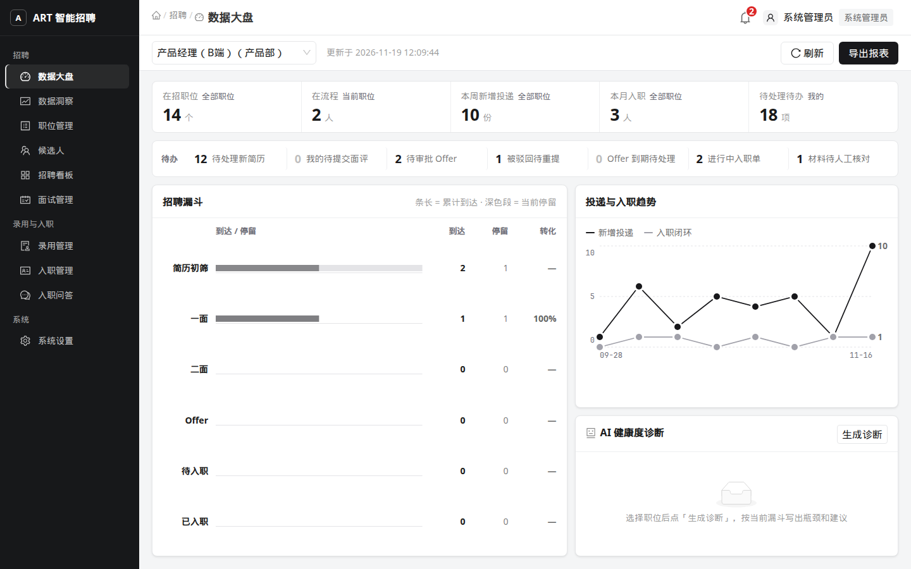
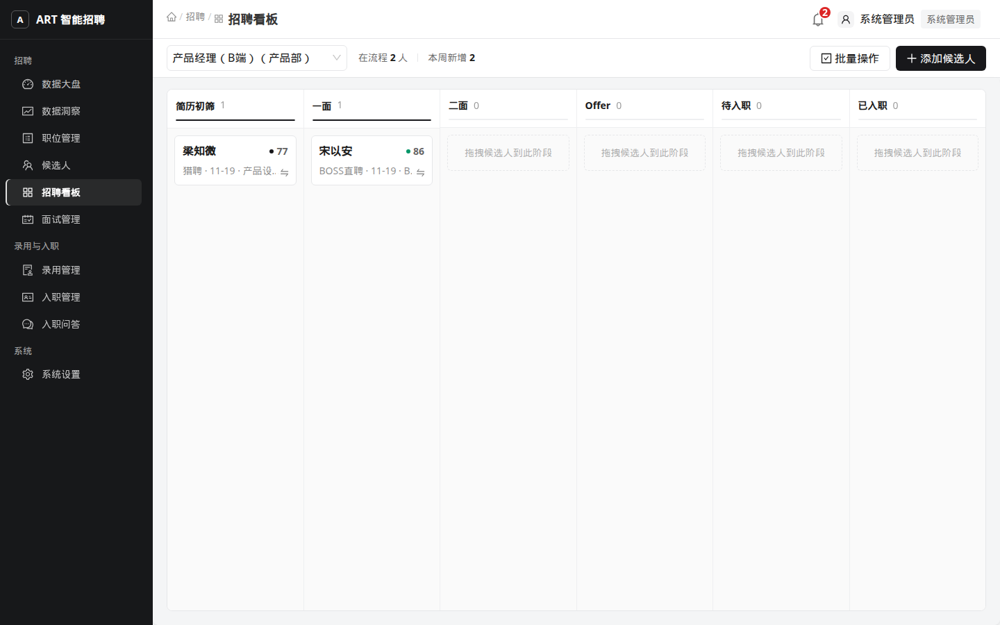

# HireFlow

给招聘团队用的全栈 ATS：职位、候选人、面试、Offer 和入职在同一条流程里。界面上的产品名是 ART 智能招聘。





## 功能

- 职位有草稿、待审批、招聘中、暂停和关闭。每个职位可以改自己的流程阶段。
- 看板拖动推进阶段。候选人详情在抽屉里，包含简历、面评和时间轴。
- 面试排期和面评。候选人用免登录链接选时间、答复 Offer、提交入职材料。
- 权限分两轴：能做什么，以及能看谁的数据（全部、本部门、仅指派、仅本人）。没有 `salary:view` 就看不到薪资。
- 数据大盘和洞察：漏斗、渠道、面试官和招聘周期。
- AI 网关负责 JD、简历解析、匹配、面评草稿和漏斗诊断。没有模型 key 时走内置规则引擎。

## 技术栈

React 19、Vite、Ant Design、NestJS 11、Prisma、PostgreSQL（本地用 PGlite，不必先装数据库）。npm workspaces，Node.js >= 20.19。

## 值得看的地方

- 功能权限和数据范围分开。每次请求按库里的当前角色重算，停用账号不用等 JWT 过期。
- 看板移动可以带版本号。并发改同一张卡时返回 409。
- `packages/shared` 同时给前后端提供枚举和权限码。

## 本地运行

需要 Node.js 20.19 或更高。不用先装 Docker 或 PostgreSQL。

```bash
git clone https://github.com/suijiafeng/hireflow-recruitment-platform.git
cd hireflow-recruitment-platform
npm install
cp apps/api/.env.example apps/api/.env
npm run dev
```

浏览器打开 http://localhost:5173 。API 在 http://localhost:3000/api 。

种子账号的密码都是 `Admin@123456`：

| 邮箱 | 角色 |
| --- | --- |
| `admin@arthr.local` | 系统管理员 |
| `hr@arthr.local` | HR |
| `manager@arthr.local` | 用人经理 |
| `interviewer@arthr.local` | 面试官 |
| `it@arthr.local` | IT / 行政 |

不启动对象存储时，文件上传不可用，登录和其他页面仍可用。变量说明在 `apps/api/.env.example`。

## 目录

```text
apps/api          NestJS
apps/web          React
packages/shared   共用枚举和权限码
```

## 许可证

[MIT](./LICENSE)
