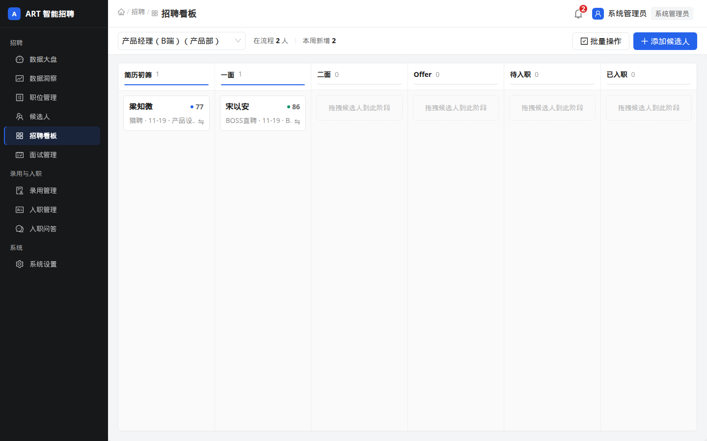

# HireFlow

给招聘团队用的全栈 ATS：职位、候选人、面试、Offer 和入职在同一条流程里。界面上的产品名是 ART 智能招聘。

<table>
  <tr>
    <td width="400" valign="top">
      
      <br />看板：按阶段拖动候选人
    </td>
    <td width="400" valign="top">
      
      <br />洞察：渠道、面试官和招聘周期
    </td>
  </tr>
  <tr>
    <td width="400" valign="top">
      
      <br />录用：审批、发送和候选人答复
    </td>
    <td width="400" valign="top">
      
      <br />手机宽度：指标收成两列
    </td>
  </tr>
</table>

## 功能

- 职位有草稿、待审批、招聘中、暂停和关闭。每个职位可以改自己的流程阶段。
- 看板拖动推进阶段。候选人详情在抽屉里，包含简历、面评和时间轴。
- 面试排期和面评。候选人用免登录链接选时间、答复 Offer、提交入职材料。
- 权限分两轴：能做什么，以及能看谁的数据（全部、本部门、仅指派、仅本人）。没有 `salary:view` 就看不到薪资。
- 数据大盘和洞察：漏斗、渠道、面试官和招聘周期。
- AI 网关负责 JD、简历解析、匹配、面评草稿和漏斗诊断。支持 Anthropic 和 OpenAI 兼容接口（DeepSeek、通义千问、本地 vLLM 等），没有模型 key 时走内置规则引擎。

## 技术栈

React 19、Vite、Ant Design、NestJS 11、Prisma、PostgreSQL（本地用 PGlite，不必先装数据库）。npm workspaces，Node.js >= 20.19。

## 值得看的地方

- 功能权限和数据范围分开。每次请求按库里的当前角色重算，停用账号不用等 JWT 过期。
- 看板移动可以带版本号。并发改同一张卡时返回 409。
- `packages/shared` 同时给前后端提供枚举和权限码。
- AI 管线有工程兜底：
  - 统一的超时预算和全局并发上限，超时自动降级到规则引擎。
  - 简历按不可信数据处理：加边界标签、脱敏联系方式，技能标签落库前归一化，匹配分必须引用简历原文作为证据。
  - 每次调用写 `AiCallLog`，系统设置里的「AI 用量」面板展示 token、估算成本、P95 延迟、缓存命中率和降级率。
  - AI 接口按用户限流。

### 接入大模型

在 `apps/api/.env` 里任选一种配置：

```bash
# Anthropic
ANTHROPIC_API_KEY="sk-ant-..."

# 或者 OpenAI 兼容接口，例如 DeepSeek
AI_BASE_URL="https://api.deepseek.com/v1"
AI_API_KEY="sk-..."
AI_MODEL="deepseek-chat"
```

本地没有 key 也能演示真实的调用链路：`node apps/api/scripts/mock-llm.mjs` 会在 3311 端口启动一个同时兼容 Anthropic Messages 和 OpenAI Chat Completions 的模拟服务，把 `ANTHROPIC_BASE_URL` 或 `AI_BASE_URL` 指向它即可。

## 本地运行

需要 Node.js 20.19 或更高。不用先装 Docker 或 PostgreSQL。

```bash
git clone https://github.com/suijiafeng/hireflow-recruitment-platform.git
cd hireflow-recruitment-platform
npm install
cp apps/api/.env.example apps/api/.env
npm run dev
```

浏览器打开 http://localhost:5173 。API 在 http://localhost:3000/api 。

种子账号的密码都是 `Admin@123456`：

| 邮箱 | 角色 |
| --- | --- |
| `admin@arthr.local` | 系统管理员 |
| `hr@arthr.local` | HR |
| `manager@arthr.local` | 用人经理 |
| `interviewer@arthr.local` | 面试官 |
| `it@arthr.local` | IT / 行政 |

不启动对象存储时，文件上传不可用，登录和其他页面仍可用。变量说明在 `apps/api/.env.example`。

### 安全相关开关

- **演示账号**：开发环境登录页默认列出上面的账号并预填密码。生产构建默认**不展示、不预填**；公开演示站构建时显式传 `VITE_DEMO_MODE=true`（Docker：`--build-arg VITE_DEMO_MODE=true`）才会列出账号，且仍不预填密码。正式部署请勿使用种子账号。
- **登录限流**：按「账号 + 来源 IP」渐进退避（5 次失败后 30s 起翻倍，封顶 15 分钟），不会因为别人输错你的密码而把你锁在外面。部署在反向代理后面时务必配置 `TRUST_PROXY`，否则拿不到真实 IP，只能退化为按账号退避（最长 60 秒）。
- **会话吊销**：修改密码、管理员重置密码、停用账号、「退出其他设备」都会让该账号此前签发的所有令牌立即失效。
- **候选人 / 新员工门户链接**有硬过期时间（预筛、选时 7 天；Offer 答复截止后 7 天；入职 60 天），过期显示「链接已过期」；HR 可重新生成链接让旧链接立即作废。

## 目录

```text
apps/api          NestJS
apps/web          React
packages/shared   共用枚举和权限码
```

## 许可证

[MIT](./LICENSE)
